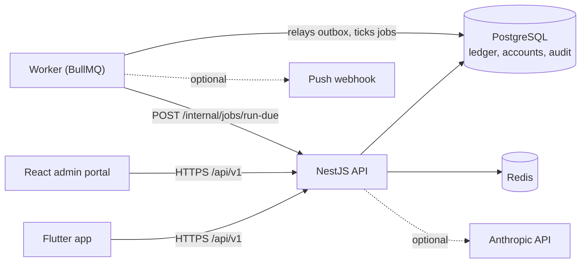

<div align="center">


# Zentrix Bank V2

**A full-stack digital banking _simulation_: customer mobile app, staff admin portal, double-entry ledger API and background worker.**


[Issues](https://github.com/DushanSenura/Zentrix-Bank-V2/issues) · [Progress log](PROGRESS.md) · [Architecture](docs/architecture/overview.md) · [Release notes](docs/release/v2.0.0-release-notes.md)

</div>

> **Simulation only.** Identities, accounts and money are fictional. This is not a licensed bank, holds no real funds, and is not approved for production banking use.

## Table of contents
- [Overview](#overview)
- [Screenshots](#screenshots)
- [Features](#features)
- [Technology stack](#technology-stack)
- [Architecture](#architecture)
- [Getting started](#getting-started)
- [Environment variables](#environment-variables)
- [Commands](#commands)
- [Project structure](#project-structure)
- [API](#api)
- [Database](#database)
- [Authentication and authorization](#authentication-and-authorization)
- [Security](#security)
- [Testing and quality](#testing-and-quality)
- [Deployment](#deployment)
- [Known limitations](#known-limitations)
- [Contributing, license, support](#contributing-license-support)

## Overview
Zentrix Bank V2 is a rebuild of the [V1 prototype](https://github.com/DushanSenura/Zentrix-Bank) (used as a read-only reference) with a real backend. Every balance comes from an append-only, double-entry ledger in PostgreSQL; the mobile app and admin portal only display what the bank has recorded.

It is built for learning, demonstration and portfolio use: it shows how a banking product's moving parts fit together (ledger integrity, idempotent payments, PIN step-up, maker-checker approvals, audit logging, role-based staff access) without touching real money or real banking networks.

## Screenshots
No screenshots are committed to this repository yet, so none are shown here rather than using mock-ups. Useful ones to add under `docs/screenshots/`: login, home dashboard, payment review and receipt, cards, analytics, and the admin dashboard and approval queues.

## Features
Everything below is implemented in the source and covered by tests unless marked. Nothing has been run on a physical device by the maintainers' test suite (widget and API tests only). Details: [parity status](docs/v1-migration/parity-status.md).

### Customer mobile app (Flutter)
| Area | What it does |
| --- | --- |
| Sign-in and registration | Five-step registration with identity details for staff review; sign-in by username, email or customer ID; password reset with a 6-digit code (code delivery is development-only, see [limitations](#known-limitations)); optional authenticator-app two-step sign-in with recovery codes; app PIN; biometric unlock; auto-lock; session-expiry handling |
| Accounts | Savings, current and foreign-currency (USD/EUR/GBP) accounts; open an account, optionally paying the opening deposit from another account; monthly money in/out; statements as PDF and CSV |
| Payments | Own-account, saved-recipient and new-recipient transfers; other-bank transfers with a fee; bill payments; QR pay and My QR; scheduled and repeating payments with history; save a recipient after paying; receipts as PDF; every payment authorised with the server-verified PIN (optional biometric release) |
| Currency exchange | Bank-quoted rates valid for 60 seconds, posted as two balanced ledger journals |
| Cards | Debit, virtual and credit requests, activation, freeze, spending controls, card PIN, report lost, permanent block |
| Deposits and loans | Fixed deposits (open, early closure, renewal, certificates); personal, education, vehicle and home loans with calculator, repayment schedule, settlement |
| Money management | Savings goals with target date and monthly auto-save; budgets with alerts and suggestions; analytics (income, spending, categories, trend); eight spending categories |
| History and support | Searchable, filterable transaction history and details; disputes; support tickets and appointments; branch and ATM finder; global search; FAQs |
| Profile and security | Editable contact details (PIN-protected), notification preferences, transfer limits, trusted devices, sessions, login history, recent security alerts |
| Experience | Light and dark themes, reduce-motion support, offline banner, maintenance screen, accessibility tests at large text sizes |

### Staff admin portal (React)
Sign-in with mandatory authenticator code; role-aware navigation; customer and KYC review; account, card, loan and fixed-deposit approval queues; transaction monitoring, reversals and ledger adjustments (second approver required); reports and CSV exports; audit log; risk alerts; support, disputes and branches; exchange rates; system settings; staff and role management; announcements to customers.

### Backend
Double-entry ledger with database triggers that forbid editing or deleting posted entries, idempotency keys, transactional outbox, risk rules and reminders run by a scheduled tick, optional AI help (off unless configured), push webhook (optional).

**Experimental / optional:** AI-written help answers and insight wording (`ANTHROPIC_API_KEY`, never required); anomaly detection (off by default, labelled as an experiment).
**Not built:** customisable home widgets, phone push registration, Sinhala/Tamil app screens (statements and receipts are translated), foreign-currency payments to other people, sample QR codes.

## Technology stack
| Layer | Technologies |
| --- | --- |
| Mobile | Flutter (Dart SDK ^3.12.1), Riverpod, go_router, Dio, flutter_secure_storage, local_auth, mobile_scanner, share_plus, connectivity_plus |
| Admin portal | React, Vite, TypeScript, Tailwind CSS, TanStack Query, React Router; tests with Vitest, Testing Library and axe-core; oxlint |
| API | Node.js (≥ 20), NestJS, TypeScript, Zod validation, Swagger, `@nestjs/throttler` |
| Worker | Node.js, TypeScript, BullMQ |
| Data | PostgreSQL 16 via Prisma (migrations in `database/prisma/migrations`), Redis 7 |
| Tooling | pnpm workspaces (pnpm 10.15.1), Vitest, Docker / Docker Compose, nginx, GitHub Actions |

## Architecture

The API writes business changes and notification events in one database transaction (outbox pattern); the worker turns events into in-app notifications and calls a shared-secret job endpoint on a schedule for scheduled payments, deposit maturity, loan reminders and risk scans. More: [architecture overview](docs/architecture/overview.md), [auth and RBAC](docs/security/auth-and-rbac.md).

## Getting started
**Prerequisites:** Node.js ≥ 20, pnpm 10, Docker (for PostgreSQL and Redis), Flutter (stable, Dart ^3.12.1) for the mobile app.

```bash
git clone https://github.com/DushanSenura/Zentrix-Bank-V2.git
cd Zentrix-Bank-V2
cp .env.example .env     # then fill the values marked below
pnpm install
pnpm db:up               # PostgreSQL + Redis (Redis on host port 6380)
pnpm db:generate         # Prisma client
pnpm --filter @zentrix/database migrate:deploy
pnpm db:seed             # roles/permissions and fictional demo users
```
Set in `.env` before starting: a local `POSTGRES_PASSWORD` (and the same in `DATABASE_URL`), `JWT_ACCESS_SECRET`, `DATA_ENCRYPTION_KEY` and `INTERNAL_JOB_TOKEN` (generation commands are in `.env.example`).

Run the services (separate terminals):
```bash
pnpm api:dev      # http://localhost:3000/api/v1/health, Swagger at /api/docs
pnpm worker:dev   # outbox relay and scheduled-job tick
pnpm admin:dev    # http://localhost:5173
```
Mobile (Android emulator reaches the host at `10.0.2.2`; use your LAN IP on a real device):
```bash
cd apps/mobile
flutter pub get
flutter run --dart-define=API_BASE_URL=http://10.0.2.2:3000
```
**Verify:** `curl http://localhost:3000/api/v1/health` should report the database and Redis as `up`. Seeding writes demo logins to `.local-dev-credentials.json` (git-ignored). In development builds the login screens list the demo accounts; this panel is compiled out of production builds and the API route behind it answers 404 outside `APP_ENV=development`.

## Environment variables
Validated at API start-up (`services/api/src/config/env.ts`); empty values count as unset.

| Variable | Required | Purpose / default |
| --- | --- | --- |
| `DATABASE_URL` | Yes | PostgreSQL connection string |
| `REDIS_URL` | Yes | Redis connection string (`redis://localhost:6380` locally) |
| `JWT_ACCESS_SECRET` | Yes | Access-token signing secret, at least 32 characters |
| `DATA_ENCRYPTION_KEY` | Yes | Base64 of exactly 32 random bytes; encrypts personal data and authenticator secrets |
| `INTERNAL_JOB_TOKEN` | For scheduled jobs | Shared secret (≥ 32 chars) between worker and API; unset disables scheduled payments |
| `APP_ENV` | No | `development` (default), `staging` or `production` |
| `API_PORT` | No | Default `3000` |
| `API_CORS_ORIGINS` | No | Default `http://localhost:5173` |
| `ACCESS_TOKEN_TTL_SECONDS` | No | Default 600 |
| `CUSTOMER_SESSION_DAYS` / `STAFF_SESSION_HOURS` | No | Defaults 30 days / 12 hours |
| `ALLOW_SETUP_TOKEN_IN_RESPONSE` | No | Default `false`; staging-only convenience for staff invites |
| `ANTHROPIC_API_KEY`, `AI_MODEL` | No | Enable optional AI wording; unset means the AI features report themselves off |
| `PUSH_WEBHOOK_URL`, `PUSH_WEBHOOK_TOKEN` | No | Optional HTTP push gateway used by the worker |
| `TEST_DATABASE_URL` | For tests | Separate migrated database; database-backed API tests are skipped without it |
| `POSTGRES_USER`, `POSTGRES_PASSWORD`, `POSTGRES_DB` | Docker | Used by `docker-compose.yml` |

`.env.example` lists most of these; the session and AI-setup variables above are read by the API but not yet listed there. The mobile app takes `API_BASE_URL` (and optional certificate pins, `API_PINS`) as `--dart-define` build options, not from `.env`. Never commit real secrets.

## Commands
| Command | What it does |
| --- | --- |
| `pnpm db:up` | Start PostgreSQL and Redis containers |
| `pnpm db:generate` | Generate the Prisma client |
| `pnpm db:migrate` | Create/apply migrations in development |
| `pnpm --filter @zentrix/database migrate:deploy` | Apply existing migrations |
| `pnpm db:seed` | Seed roles, permissions and fictional demo users |
| `pnpm api:dev` / `worker:dev` / `admin:dev` | Development servers |
| `pnpm build` | Build every workspace package |
| `pnpm typecheck` | Type-check every package |
| `pnpm test` | Run API, worker and admin tests |
| `pnpm --filter @zentrix/admin lint` | Lint the admin portal (oxlint) |
| `pnpm --filter @zentrix/api bootstrap-admin` | Create the first Super Admin (built API; see [staging guide](docs/deployment/staging.md)) |
| `cd apps/mobile && flutter analyze && flutter test` | Analyse and test the mobile app |

## Project structure
```text
apps/
  mobile/          Flutter customer app (lib/features/*, lib/core/*, test/)
  admin/           React + Vite staff portal (src/features/*, src/__tests__/)
services/
  api/             NestJS API (src/modules/*, test/)
  worker/          BullMQ worker: outbox relay, scheduled-job tick
database/          Prisma schema and migrations
packages/          Shared workspace packages
infrastructure/    Dockerfiles, nginx, staging compose stack, backup/restore and smoke scripts
docs/              Architecture, security, testing, deployment, release, UI and V1 migration notes
.github/workflows/ CI
```

## API
Base path `/api/v1`; interactive Swagger UI at `/api/docs` when the API is running. Customer routes require a bearer token from `POST /auth/login`; staff routes name the permission they need and the guard denies anything not explicitly allowed. A route-matrix test fails the build if a route is added without a declared access rule.

| Group | Examples |
| --- | --- |
| Auth | `/auth/register`, `/auth/login`, `/auth/refresh`, `/auth/password-reset/request|confirm` |
| Accounts and payments | `/accounts`, `/payments` (needs an `Idempotency-Key` header), `/payments/:id/authorize`, `/beneficiaries`, `/scheduled-payments` |
| Products | `/cards`, `/fixed-deposits`, `/loans`, `/savings/goals`, `/budgets`, `/fx/quote`, `/fx/exchange` |
| Insight and documents | `/transactions`, `/analytics/*`, `/accounts/:id/statement`, `/search` |
| Customer security | `/security/*`, `/me/profile`, `/me/preferences` |
| Staff | `/admin/*` (customers, KYC, approvals, ledger operations, risk, settings, staff, announcements) |
| Internal | `/internal/jobs/run-due` (shared-secret, called by the worker) |

Errors use a consistent `{ code, message, fields? }` shape. A global limit of 240 requests per minute applies, with stricter limits on sign-in and reset routes. Money is always an integer in minor units (cents).

## Database
PostgreSQL via Prisma, 56 models (see [schema](database/prisma/schema.prisma)). Main groups: identity and RBAC (`User`, `Role`, `Permission`, `Session`), customers and KYC, accounts and products, the ledger (`LedgerAccount`, `LedgerJournal`, `LedgerPosting`), payments (`PaymentInstruction`, `IdempotencyRecord`), cards, deposits, loans, savings and budgets, support, risk, audit (`AuditLog`, `SecurityEvent`) and the outbox. Migrations are plain SQL under `database/prisma/migrations`. Backup and restore scripts live in `infrastructure/scripts` ([guide](docs/deployment/backup-restore.md)).

## Authentication and authorization
- Customers sign in with a password; sessions use short-lived access tokens plus rotating refresh tokens. A separate app PIN is verified by the server for every payment and sensitive change; repeated failures sign the customer out.
- Staff sign-in requires an authenticator code. Roles: Super Administrator, Bank Administrator, Branch Manager, Operations Officer, Customer Service, Account Officer, Loan Officer, Card Officer, Compliance Officer, Auditor, each mapped to named permissions.
- Customer data access is scoped to the caller in every query; a cross-customer isolation test sweeps the customer routes.
- Ledger adjustments and reversals use maker-checker approval. Details: [docs/security/auth-and-rbac.md](docs/security/auth-and-rbac.md).

## Security
Implemented measures: password hashing, AES-256-GCM encryption of personal data and authenticator secrets, Zod validation on request bodies, deny-by-default route guards, request throttling, audit log and security events, idempotent payment creation, append-only ledger enforced by database triggers, optional certificate pinning in the mobile app, Android screenshot blocking and an app-switcher privacy cover, and `pnpm audit` in CI. These reduce risk but are not a security guarantee: **no independent security review has been done.** There is no `SECURITY.md` yet; report issues through GitHub Issues without including secrets or personal data.

## Testing and quality
| Suite | Tooling | Notes |
| --- | --- | --- |
| API | Vitest with a real PostgreSQL test database | Needs `TEST_DATABASE_URL`; includes route-matrix, isolation, migration and index tests |
| Worker | Vitest | Outbox relay behaviour |
| Admin | Vitest, Testing Library, axe-core | Includes accessibility checks |
| Mobile | `flutter test` | Widget tests with a fake API, accessibility and responsive matrix tests (8 viewports × 3 text scales) |

At the last full run (2026-11-20/21): API 227 tests, worker 5, admin 50, Flutter 1,218 passed. No coverage report is generated. [Testing notes](docs/testing/quality-and-security.md), [responsive audit](docs/ui/responsive-audit.md). CI (`.github/workflows/ci.yml`) runs backend/admin typecheck, tests and build, mobile analyze and tests, `pnpm audit`, and compose-file validation. CI has not been observed running on GitHub by the maintainers.

## Deployment
A staging stack is provided (`infrastructure/docker-compose.staging.yml`, Docker images for the API and admin portal behind nginx) and was verified locally with Docker only. See the [staging guide](docs/deployment/staging.md), [monitoring](docs/deployment/monitoring.md), [Android](docs/deployment/android-release.md) and [iOS](docs/deployment/ios-release.md) release notes and the [release checklist](docs/release/checklist.md). Release builds refuse to sign with the debug key. No hosted deployment or live demo exists. Production banking use is out of scope.

## Known limitations
- Password-reset codes are not delivered anywhere (no email/SMS channel); they appear on screen only in development.
- Biometric payment approval, when switched on, keeps the app PIN in the phone's secure storage; the bank still verifies it on every payment.
- No hosted demo; the app has not been run on physical devices by the maintainers' tests; Sinhala/Tamil wording is unreviewed by a native speaker.
- Exchange is between a customer's own accounts only; no international or foreign-currency payments to others.
- See [PROGRESS.md](PROGRESS.md) for the complete, dated list of limits per phase.

## Contributing, license, support
- **Contributing:** there is no `CONTRIBUTING.md` yet. If you open a pull request, run `pnpm typecheck && pnpm test` and `flutter analyze && flutter test` first and keep changes focused.
- **License:** no license file has been specified for this repository, so all rights are reserved by default. Ask the owner before reuse.
- **Author:** [Dushan Senura](https://github.com/DushanSenura).
- **Support:** open a [GitHub issue](https://github.com/DushanSenura/Zentrix-Bank-V2/issues).
